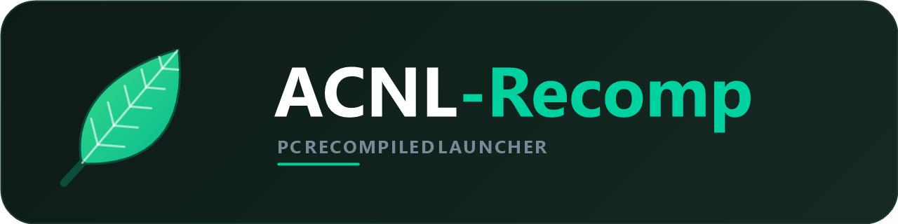

<p align="center">
  
  <br>
  <a href="https://opencode.ai">
    
  </a>
</p>

# ACNL-Recomp — launcher e instalador

Código-fonte do launcher e do instalador do **ACNL-Recomp**, a recompilação
estática de *Animal Crossing: New Leaf* (Nintendo 3DS) para x86_64 no Windows.

O projeto não contém ROM, assets, saves ou código do jogo. Você precisa de uma
cópia legítima do jogo e gerar o seu próprio dump (`.3ds` ou `.cxi`).

> **Usuário final:** baixe o instalador pronto na página de
> [Releases](../../releases) — não é preciso compilar nada.

---

## O que tem neste repositório

| Pasta | Conteúdo |
| :--- | :--- |
| `launcher/` | Launcher em PowerShell/WPF (`ACNL-Launcher.ps1`) e o `launcher_config.json` padrão |
| `installer/` | `ACNL-Bootstrap.ps1` (baixa Zakuro e w64devkit), `installer.iss` (Inno Setup) e o ícone |
| `build/` | Scripts que compilam o launcher, o instalador e a versão portátil |
| `portable/` | `INICIAR.cmd` e `ATUALIZAR-DEPENDENCIAS.cmd` da versão portátil |
| `docs/` | `LEIA-ME.txt` (usuário final), `COMO-COMPILAR.md` e `PUBLICAR.md` |
| `assets/` | Logo e ícone do projeto (SVG, PNG e `.ico`) |

---

## Como o projeto funciona

1. O **instalador** (Inno Setup) copia o launcher, o bootstrap e o
   `3dsrecomp.exe` para `%LOCALAPPDATA%\ACNL-Recomp`.
2. No fim da instalação, o **bootstrap** baixa da página oficial de releases:
   - **Zakuro** — runtime HLE do 3DS;
   - **w64devkit** — GCC portátil usado na recompilação.
   Os downloads são verificados por SHA256, com até 3 tentativas e exibição de
   velocidade/ETA.
3. O **launcher** configura o Zakuro, mostra estatísticas, gráficos e controles,
   dispara o `3dsrecomp` e inicia o jogo. Ele também mantém o título da janela
   como `Animal Crossing: New Leaf` e aplica o ícone da folha.

---

## Compilar do código

Passo a passo completo em [`docs/COMO-COMPILAR.md`](docs/COMO-COMPILAR.md).

Resumo:

```powershell
# 1. dependências (uma vez)
Install-Module ps2exe -Scope CurrentUser

# 2. coloque 3dsrecomp.exe em installer\

# 3. compila launcher + bootstrap
powershell -ExecutionPolicy Bypass -File build\build-launcher.ps1

# 4. gera o instalador
powershell -ExecutionPolicy Bypass -File build\build-installer.ps1

# 5. (opcional) monta a versão portátil
powershell -ExecutionPolicy Bypass -File build\build-portable.ps1
```

Para testar o launcher sem compilar:

```powershell
powershell -ExecutionPolicy Bypass -File launcher\ACNL-Launcher.ps1
```

---

## Recursos do launcher

- **Jogar:** ROM, Recompilar (com progresso real e botão Cancelar), JOGAR,
  abrir saves, backup, log e `settings.toml`.
- **Janela do jogo:** título limpo, só `Animal Crossing: New Leaf`, com o ícone
  da folha.
- **Gráficos:** API gráfica, rasterizador, resolução interna 1x–4x, tamanho da
  janela, disposição das telas, formato da tela, filtro, escala inteira, 3D,
  texturas HD e interpolação de frames.
- **Preencher tela (16:9):** botão que usa apenas a tela superior no formato
  widescreen, eliminando as bordas pretas no fullscreen. No jogo, `F10` alterna
  para a tela inferior.
- **Controles:** remapeamento completo de teclado e controle.
- **Estatísticas:** tempo total, sessões, última sessão e histórico recente.
- **Sobre:** informações do projeto, créditos e aviso legal.

---

## Identidade visual

A logo e o ícone ficam em [`assets/`](assets):

| Arquivo | Uso |
| :--- | :--- |
| `logo.svg` / `banner.png` | Banner horizontal (1280×320) para o README e divulgação |
| `logo-claro.svg` / `logo-escuro.svg` | Versões sem fundo, para fundo claro e escuro |
| `icone.svg` / `icone.png` | Ícone quadrado (512×512) |
| `icone-transparente.svg` | Ícone sem fundo |
| `acnl-recomp.ico` | Ícone multi-resolução (16–256) para Windows |

As cores seguem a paleta do launcher: verde `#00B894` / `#3DDC84` sobre fundo
escuro `#0E1A16`.

---

## Aviso legal

Este projeto **não contém e não distribui ROM, assets ou qualquer material
protegido por direitos autorais da Nintendo**. É necessário possuir uma cópia
legítima do jogo e gerar o seu próprio dump.

*Animal Crossing* e *Nintendo 3DS* são marcas registradas da Nintendo Co., Ltd.
Projeto sem fins lucrativos, para uso pessoal e preservação.

Zakuro e 3dsrecomp são distribuídos sob a licença MIT. O w64devkit (GCC) tem
licenças próprias. Veja [`THIRD-PARTY-NOTICES.txt`](THIRD-PARTY-NOTICES.txt).

---

## Créditos

- **Lucas4411** — autor do projeto e do launcher — <https://github.com/Lucas4411>
- **OpenCode** — agente de IA usado no desenvolvimento — <https://opencode.ai>
- [3dsrecomp](https://github.com/fearkov/3dsrecomp) — recompilador estático de
  binários ARM11 do Nintendo 3DS.
- [Zakuro](https://github.com/fearkov/zakuro) — runtime e emulador HLE em Rust.
- [w64devkit](https://github.com/skeeto/w64devkit) — kit portátil com GCC.
- [Inno Setup](https://jrsoftware.org/isinfo.php) — gera o instalador.
- [ps2exe](https://github.com/MScholtes/PS2EXE) — compila o launcher PowerShell
  em `.exe`.

Lista completa de pessoas e projetos em [`CONTRIBUTORS.md`](CONTRIBUTORS.md).
